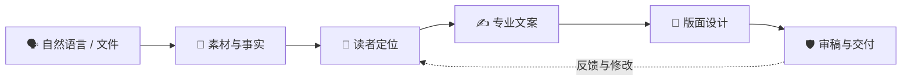

<div align="center">

# Resume Narrative Studio

### 让经历被看见，让能力被理解。

**从一段说不清的自我介绍，到一份有证据、有个性、有设计感的简历。**

`讲经历，你来判断；做研究、写文案、排版和审稿，交给 Agent。`

<br/>

[](LICENSE)


**[🎨 风格实验室](style-gallery.html) · [🪪 头像位置实验室](photo-policy-gallery.html) · [📖 Skill 入口](SKILL.md) · [🧭 使用指南](#-三分钟上手)**

<sub>Open source · 中文优先 · 人类始终拥有最终决定权</sub>

</div>

---

> **你做过很多事，但简历上只有“参与过”“负责过”“具备较强能力”？**
>
> 简历里最难的部分，往往不是写下经历，而是找到那些能让读者看懂你的人、你的判断和你的贡献的证据。
>
> Resume Narrative Studio 会先听你讲，再读你提供的材料，然后陪你决定：**哪些值得写、为什么值得写、怎样写得专业且有吸引力。**

## ✨ 它能帮你做什么？

<table>
<tr>
<td width="50%" valign="top">

**01 · 挖掘你的真实经历**

从自然语言、旧简历、项目资料、证书和公开作品中整理事实。只追问缺失的关键信息，不让你从头填几十页表格。

</td>
<td width="50%" valign="top">

**02 · 把经历写成能力**

围绕目标读者，提炼个人贡献、真实产物和可迁移能力。压低空话、术语堆叠和机械的“AI 味”。

</td>
</tr>
<tr>
<td valign="top">

**03 · 为你选择合适的版式**

12 种结构 × 12 套配色 × 7 组字体 × 3 档阅读节奏。保留喜欢的布局，单独改颜色和字体。

</td>
<td valign="top">

**04 · 让你在重要节点做决定**

定位、结构、关键文案、照片、最终版式都可以调整。你的反馈会改变后续写作方法，不只是修改某个词。

</td>
</tr>
</table>

## 🎨 Design Lab：简历也可以有自己的审美

一份正式的学术简历，和一份年轻创作者的作品集，不需要长得一样。

**我们按“结构”区分风格，而不是把同一张简历换 12 种颜色。**

| 克制、专业 | 编辑感、个人风格 | 年轻、大胆 |
| :--- | :--- | :--- |
| 清晰单栏 | 象牙书信 | 大字海报 |
| 横向身份区 | 书卷编辑 | 青年拼贴 |
| 学术索引 | 作品集侧栏 | 工作室网格 |
| 经历索引 | 核心作品 | 双轨档案 |

上面是风格方向示例，完整的 **12 种布局**见 [Design Lab](style-gallery.html) 和 [版式设计依据](references/11-structural-layout-patterns.md)。

- **想保留布局，只换颜色？** 配色、字体与间距可以独立混搭。
- **觉得页面太挤？** 全局密度契约禁止靠缩小正文来硬塞内容。
- **要放头像或作品图？** 根据投递地区、照片许可和阅读场景自动调整。
- **机器投递？** 使用单栏、无装饰的 ATS 候选版，并另行检查实际解析结果。

> **预览提示**：GitHub 会把 `.html` 当作源文件显示。想操作 Gallery，请下载仓库并在本地浏览器打开 `style-gallery.html`；仓库本身公开不代表 GitHub Pages 已启用。

<details>
<summary><strong>🧩 这 12 种布局有什么区别？展开看看</strong></summary>

<br/>

| 布局 | 设计特点 |
| --- | --- |
| `ats-clean` | 单栏、无头像与装饰的机器投递候选 |
| `formal-split` | 身份信息横向分区，适合正式简历 |
| `research-ledger` | 学术型结构索引，重视研究经历 |
| `ivory-classic` | 书信式居中排版，克制且精致 |
| `book-editorial` | 出版物式视觉层级，强调阅读节奏 |
| `studio-grid` | 模块化单双栏与跨栏组织 |
| `product-feature` | 代表作品前置，突出个人贡献 |
| `portfolio-rail` | 人物信息侧栏与作品叙事 |
| `experience-index` | 以时间、经历和角色构成清晰索引 |
| `bold-poster` | 大字号与强对比，适合创意表达 |
| `pop-blocks` | 非对称色块，年轻、活泼 |
| `two-track` | 核心经历与辅助资历的双轨组织 |

头像 A/B 对照和中文正式简历的头像位置规范：[Photo Policy Lab](photo-policy-gallery.html) · [设计依据](references/19-chinese-formal-photo-design.md)。

</details>

## 🚀 三分钟上手

### 路线 A · 直接交给你的 AI Agent

1. 下载或克隆本仓库。
2. 让 Agent 读取 [`SKILL.md`](SKILL.md) 及其引用的 `references/`、`templates/` 文件。
3. 用自己的话开始聊天，想补充什么再补充，不需要提前整理出“完美材料”。

**可以直接复制的第一句话：**

```text
请使用 Resume Narrative Studio 帮我制作一份简历。

我会用自然语言讲经历，也可能补充文件、图片和作品链接。
请先理解简历要给谁看，帮我挖掘有价值的经历，
每轮最多问一两个真正影响结果的问题。

先给我定位与内容结构建议，由我决定重要的展示方向。
再完成专业文案、风格推荐、实际分页检查和成稿审查。
不要虚构成果，也不要为了塞进一页而缩小字号。
```

**已有简历？** 直接说「帮我审查这份简历，保留我喜欢的部分，重点改进文案逻辑和版面」，不必重新走完整访谈。

### 路线 B · 先玩一玩模板

零安装即可体验 HTML 预设：

```bash
git clone https://github.com/caiwu557-ai/resume-narrative-studio.git
cd resume-narrative-studio

# 在浏览器中打开 style-gallery.html
# 或使用 Python 3 生成独立 HTML
python scripts/render_resume.py \
  --input examples/sample_resume.json \
  --theme book-editorial \
  --palette ivory \
  --font serif-head \
  --rhythm airy \
  --output demo.html
```

完整混搭选项由 [`templates/design_tokens.json`](templates/design_tokens.json) 定义。示例数据均为**虚构人物**，不会带入真实用户信息。

<details>
<summary><strong>⚙️ PDF 导出、自动检查与开发者命令</strong></summary>

<br/>

Python 静态测试：

```bash
python tests/test_skill_package.py
python tests/test_personalization.py
python tests/test_photo_policy_v13.py
```

已具备 Playwright、Chromium、PyMuPDF 等可选环境时，可运行 PDF 导出及分页检查：

```bash
python scripts/export_pdf.py \
  --input examples/sample_resume.json \
  --theme studio-grid \
  --output demo.pdf \
  --chromium /path/to/chromium
```

PDF 预检不是最终人工审美验收；生成 Word 时仍需要独立检查。使用前请参阅 [质量验证报告](VALIDATION_REPORT.md)。

</details>

## 🧠 一套有用户判断机会的工作流



完整 Skill 分为 **8 个阶段**：目标与读者、素材探勘、证据访谈、个人定位、信息架构、文案编译、视觉排版、审稿交付。

这 8 步是 Agent 的内部工作流程，**不代表用户要被盘问 8 轮**。已有明确答案时直接推进；关键判断交还给人。

### 为什么要做这件事？

我们从多轮真实简历共创中发现了几个 AI 特别容易犯的错误：

- 把所有资料都堆上去，让简历像项目报告。
- 写了很多技术名词，却没告诉读者“这个人做出了什么”。
- 为了证明严谨，把内部审计备注也写进给导师看的正文。
- 以为换个颜色就是新设计，以为缩小字体就能解决拥挤。
- 用户已经否决过的方案，下一轮又重新出现。

这个项目把这些纠错经验沉淀为流程、约束、模板和测试。具体方法见 [完整复盘](REVIEW_AND_RATIONALE.md) 和 [低心智损耗协作协议](references/15-low-friction-collaboration.md)。

## 🔐 真实、隐私与边界

- **经历要有依据。** 不虚构论文、奖项、岗位或项目成果；团队与 AI 协作的贡献按实际情况表述。
- **隐私属于用户。** 不自动公开真实简历、患者资料、证件、私有作品或未经授权的照片。
- **照片不是必填项。** 正式中文简历、创意作品集、国际投递与 ATS 采用不同规则。
- **漂亮不等于机器可读。** ATS、Word、PDF 和不同字体环境都需要单独验证。
- **独立审稿不能靠宣称。** Agent 环境未运行真正的独立审稿，就只能说明已进行自审。

本项目提供方法、模板与示例代码，不承诺录取率、面试邀请或适用于所有机构的自动格式认证。

## 🗂️ 项目地图

```text
resume-narrative-studio/
├── SKILL.md                   # Agent 的入口和协作流程
├── references/                # 写作、设计理论、隐私、审稿规范
├── templates/                 # 布局、字体、配色与照片策略
├── scripts/                   # HTML渲染、推荐、导出与检查工具
├── examples/                  # 虚构演示素材
├── tests/                     # 自动测试和压力场景
├── style-gallery.html         # 布局 × 色彩 × 字体实验室
├── photo-policy-gallery.html  # 头像位置与场景对照
└── LICENSE                    # MIT
```

## 🤝 一起把它打磨得更好

欢迎通过 [Issues](https://github.com/caiwu557-ai/resume-narrative-studio/issues) 提交真实的问题，例如：

- 「这个模板很好看，但长经历会出现奇怪的分页。」
- 「我投的是某个专业岗位，现有术语和章节不合适。」
- 「我有一套更好的字体/配色/图标组合。」
- 「某段 AI 文案看起来正确，但完全不像真人写的。」

提交前请移除真实个人联系方式、证书编号、患者资料及未经授权的作品图。参与方式见 [`CONTRIBUTING.md`](CONTRIBUTING.md)，安全问题见 [`SECURITY.md`](SECURITY.md)。

项目采用 [MIT License](LICENSE)。第三方图片、字体、商标及图标仍须遵守各自授权。

---

<div align="center">

**你的经历值得被认真理解。**

<sub>Resume Narrative Studio · Human-led. Evidence-grounded. Beautifully told.</sub>

**[⬆ 回到顶部](#resume-narrative-studio)**

</div>


## v1.4.0｜Revision reliability
- Cross-version constraint snapshots and regression receipts: `references/20-revision-continuity.md`, `scripts/revision_contract.py`.
- Evidence mining, academic application adapter: `references/21-evidence-mining-and-academic.md`.
- Semantic hierarchy, same-source delivery diagnostics: `references/22-semantic-hierarchy-and-delivery.md`, `scripts/inspect_delivery.py` (PDF requires PyMuPDF).
- Existing v1.3 templates, tokens, photo policy and CLI are retained. See `V14_UPGRADE.md` for scope and test limitations.
